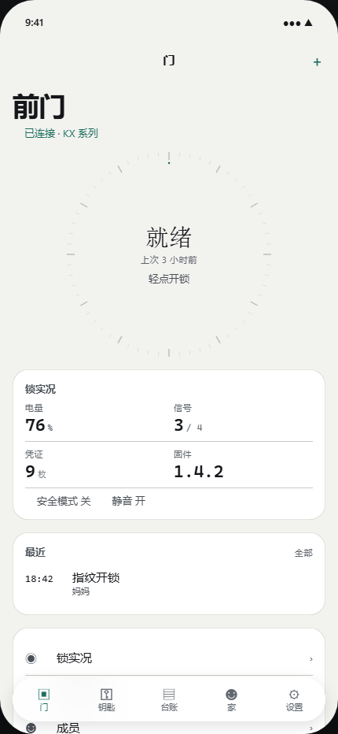
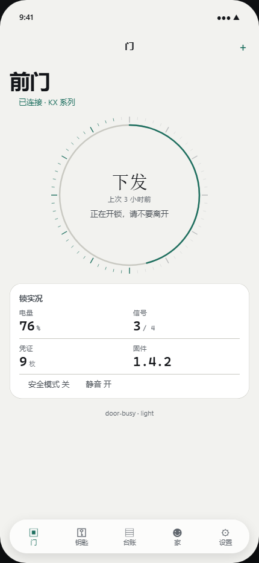

# 离线锁管家 · iOS 27 全新版

> **这是一份从 0 重做的 App，不是在 `ios-app` 上缝补。**
> 协议层照搬（那是已验证的地基），**界面层一行没留**。

```
上一版 ios-app/         这一版 ios27/
  暖金 + 「一扇门」隐喻      冷石墨/冷纸 + 「一台仪器」读数
  76 个目的地平铺            5 个 Tab + 按域分层的子页
  47 个页面各自写死样式     面板/读数/刻度/台账四种语法统一
  1.94 MB / 139 文件        1.12 MB / 113 文件（界面层全部新写）
```

---

## 30 秒看懂这是什么

**把门锁当成一台精密仪器来读，而不是把门画在屏幕上。**

上一版的隐喻是"一扇门"（门扇 / 门缝 / 锁体 / 推门而入）——那是**画**。
这一版是**读**：门锁有读数（电量、信号、凭证数、最后一次事件、固件版本），
界面就是这台仪器的面板：**刻度、读数、游标、台账**。

为什么这样更好：仪器面板是**诚实的** —— 刻度必须量到真东西，读数必须来自真协议。
而这正好是这个 App 的场景要的东西：用户站在楼道里，单手，可能很暗，开不了锁就要被关在门外。

**唯一能被记住的东西**：那枚**刻度盘**。
一圈 60 格蚀刻刻度，一段**真实进度弧**（走的是真命令链：查钥匙 → 连 BLE → cmd04 → 回执），
中心是定宽读数。失败时弧停在断点并变朱红 —— 不假装成功。




---

## 快速开始

```bash
cd ios27

# 1. 跑 9 道静态闸门（本地，不需要 Mac）
npm install
node Gates/allgates.js

# 2. 渲染视觉验收台并截图（用 Edge headless，不需要 Mac）
node DesignLab/run.js
#    → DesignLab/out/index.html   预览台（浏览器打开）
#    → DesignLab/shots/*.png      每屏浅色/深色截图

# 3. 真编译（需要 macOS + Xcode 27；或推到 GitHub 走 CI）
xcodegen generate
xcodebuild build -project LockKeeper.xcodeproj -scheme LockKeeper \
  -destination 'generic/platform=iOS' CODE_SIGNING_ALLOWED=NO
```

---

## 文档

| 文件 | 内容 |
|---|---|
| [docs/DESIGN-CONTRACT.md](docs/DESIGN-CONTRACT.md) | **设计契约（LOCKED）** —— 颜色/字体/几何/材质/动效/导航/组件/验收/11 条歧义裁决 |
| [docs/ARCHITECTURE.md](docs/ARCHITECTURE.md) | 目录、数据流、导航、组件库、闸门与视觉验收台 |
| [docs/IMPLEMENTATION-BRIEF.md](docs/IMPLEMENTATION-BRIEF.md) | 令牌/组件 API 清单与 10 条硬纪律（给下一个实施者） |
| [docs/PROGRESS-*.md](docs/) | 各域交付清单与未接真数据的部分 |

---

## 十一道机器闸门

每道都有**正控**（故意注入缺陷确认它会红），不是"写了就算数"。

| 闸门 | 判什么 | 本地 |
|---|---|---|
| `swiftparse` | **真 Swift 语法树**（tree-sitter）的 ERROR/MISSING | ✅ |
| `types` | 顶层类型重复声明 / Engine 未解析类型引用 | ✅ |
| `swiftcheck` | 括号 / 字符串 / 块注释平衡 | ✅ |
| `tokens` | 硬编码颜色/间距/圆角/字号 | ✅ |
| `contrast` | 48 条 WCAG 断言（明暗各一套，从 Tokens.swift 实解析） | ✅ |
| `glass` | 内容层不许玻璃；同屏玻璃 ≤2 | ✅ |
| `motion` | `.animation` 必带 `value:`；无裸时长；无裸 `repeatForever` | ✅ |
| `a11y` | 图标按钮必有 label；可点区 ≥44pt | ✅ |
| `callsig` | 组件调用的实参顺序必须符合声明 | ✅ |
| `lineage` | **与上一版切割**：18 个旧设计系统符号零残留 | ✅ |
| `destmap` | Dest 台账 ↔ View 实现一一对应 | ✅ |

```
$ node Gates/allgates.js
swiftparse: OK — 113 个 Swift 文件无语法错误（已知语法盲区豁免 4 处）
types:      OK — 260 个顶层类型无重复声明，Engine 无未解析引用
swiftcheck: OK — 113 个文件括号/字符串/注释全部平衡
tokens:     OK — 113 个 Swift 文件，0 处硬编码样式字面量
contrast:   48 条断言全部达标
glass:      OK — 玻璃只在功能层，同屏 ≤2，无叠玻璃
motion:     OK — 全部动画带 value，无裸时长
a11y:       OK — 图标按钮都有 label，无 <44pt 可点区
callsig:    OK — 204 处组件调用实参顺序符合声明
lineage:    OK — 0 处上一版设计系统残留
destmap:    OK — 台账与实现一一对应
```

---

## 视觉验收（为什么必须有这一层）

本机是 Windows，没有 Mac、没有 iOS 模拟器 ⇒ **SwiftUI 渲染不了**。
但"观感差"恰恰是这次要解决的问题，只靠静态闸门验不出来。

所以有了 `DesignLab/`：

```
App/Design/Tokens.swift ──解析──▶ CSS 变量（颜色/间距/圆角/字号全从 Swift 现场解析，不重写）
                                        │
                            primitives.js（每个函数镜像一个 Swift 组件）
                                        │
                            screens.js（每屏 1:1 镜像）
                                        │
                            Edge headless ──▶ shots/*.png（浅色 + 深色）
```

**能验**：版式 / 层级 / 间距 / 色彩 / 信息密度 / 空态 / 加载态 / 失败态 / 明暗双模。
**不能验**：手势手感、真实液态玻璃折射、PingFang 中文度量（Windows 用雅黑近似）。

---

## 设计纪律（违反任何一条 = 返工）

1. **同屏只有一个主角**：一枚刻度盘，或一块读数面板。不许三个卡片并排。
2. **刻度必须量到真东西**：没有量就不画刻度。
3. **数字一律等宽右对齐**（`Reading` 组件），换值不跳宽。
4. **内容层永不用玻璃**：玻璃只属于 Tab bar / 工具栏 / sheet。
5. **中文标题最高 semibold**：苹方无 Bold，`.bold()` 会静默回退。
6. **空态必须给出路**：写下一步该做什么，不是"暂无数据"。
7. **发起动作零装饰动效**，失败就停在断点。
8. **配色只有两个色相族**：石墨（无彩）+ 铜锈（唯一品牌色）。状态色不作装饰。
9. **跨 Tab 跳转走唯一漏斗** `Router.request(_:)`，一律带上下文。
10. **不许出现颜色/间距/圆角/字号字面量**，一切走 `T.` / `Ink.` / `Signal.` / `State.`。

---

## 诚实的边界

| 项 | 状态 | 说明 |
|---|---|---|
| 真机编译 | ⚠️ **未在本机验证** | 本机无 Xcode。CI 用 `macos-26` + 最新 Xcode，**必须等 CI 绿才算过编译** |
| 真机手感 | ⚠️ **未验证** | 刻度盘按压跟手度、进度弧节奏、触觉 |
| 真实玻璃折射 | ⚠️ **未验证** | DesignLab 用 `backdrop-filter` 近似 |
| 动态字体极端值 | ⚠️ **未验证** | 静态只保证字号走令牌；最大字号下截断需真机 |
| Engine ↔ 页面接线 | 🔧 **部分** | 页面里 `TODO(engine)` 标注的字段目前是 AppModel 种子数据 |
| 横屏 / iPad | ❌ **不支持** | 锁竖屏（`UISupportedInterfaceOrientations` 只有 Portrait） |

**这份 README 不会说"已完成"而掩盖上面这些。** 未验的就是未验。

---

## Engine 层说明（为什么照搬不算缝补）

`App/Engine/` 的 57 个文件是从 `ios-app/App/Core`+`Services` 照搬的**纯逻辑**：
ZK 协议帧 / KLV / AES-128-ECB / 0x88 EKey 包络 / 会话令牌 / 状态与日志解析 /
CoreBluetooth 链路 / 存储 / 备份信封 / DFU。它们有**字节级差分金标**
（40 条命令帧、NIST AES 向量、状态/日志解析、真实固件包解析），已验证。

重写它们等于把"不要 BUG"的保证丢掉。**界面层则是彻底的新东西** ——
`Gates/lineage.js` 用 18 个旧符号做机器证明：新 App 里 0 处残留。