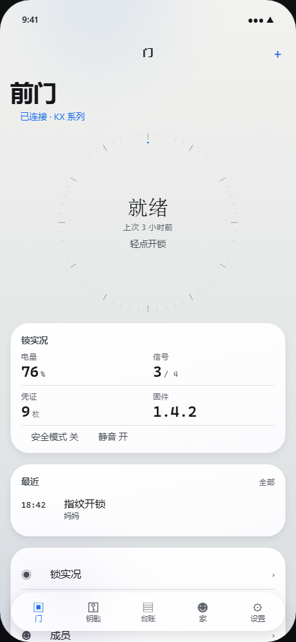
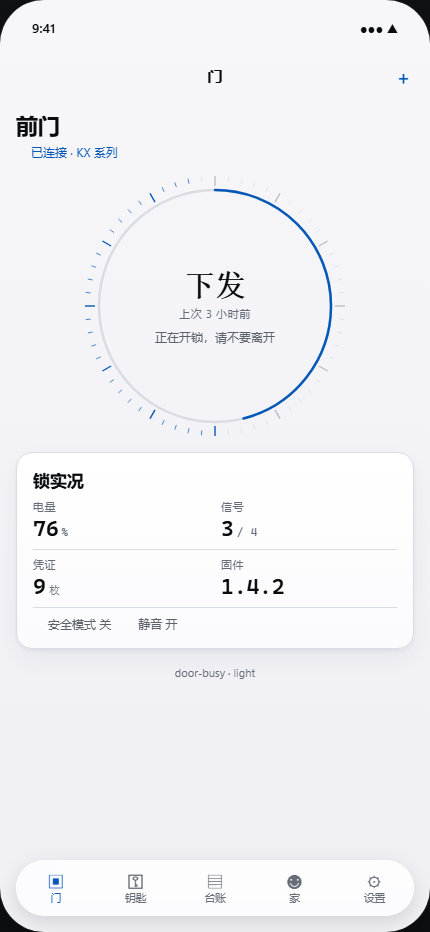

# 离线锁管家 · iOS 27 全新版

> **这是一份从 0 重做的 App，不是在 `ios-app` 上缝补。**
> 协议层照搬（那是已验证的地基），**界面层一行没留**。

```
上一版 ios-app/         这一版 ios27/
  暖金 + 「一扇门」隐喻      冷石墨/冷纸 + 「一台仪器」读数
  76 个目的地平铺            5 个 Tab + 按域分层的子页
  47 个页面各自写死样式     面板/读数/刻度/台账四种语法统一
  1.94 MB / 139 文件        1.35 MB / 148 文件（界面层全部新写）
```

---

## 30 秒看懂这是什么

**把门锁当成一台精密仪器来读，而不是把门画在屏幕上。**

上一版的隐喻是"一扇门"（门扇 / 门缝 / 锁体 / 推门而入）——那是**画**。
这一版是**读**：门锁有读数（电量、信号、凭证数、最后一次事件、固件版本），
界面就是这台仪器的面板：**刻度、读数、游标、台账**。

为什么这样更好：仪器面板是**诚实的** —— 刻度必须量到真东西，读数必须来自真协议。
而这正好是这个 App 的场景要的东西：用户站在楼道里，单手，可能很暗，开不了锁就要被关在门外。

**唯一能被记住的东西**：那枚**刻度盘**。
一圈 60 格蚀刻刻度，一段**真实进度弧**（走的是真命令链：查钥匙 → 连 BLE → cmd04 → 回执），
中心是定宽读数。失败时弧停在断点并变朱红 —— 不假装成功。




---

## 下载安装（不需要 Mac）

**最新构建（公开直链，未签名 IPA）：**

打开 https://github.com/monsm/ios-app/releases/tag/ios27-latest 下载其中的 `.ipa`
（每次构建只保留最新一个，文件名带构建时刻）。
> ⚠️ 请**只点 Release 页**，不要收藏/引用具体文件名 —— 每次构建都会删旧传新，写死的文件名必然 404。

> 未签名 = 用你自己的 Apple ID 签一次才能装。任选其一：
> - **AltStore / Sidekick**：装到手机，7 天自动续签（免费账号）
> - **Sideloadly**（Windows/Mac）：拖入 ipa，输 Apple ID，签完直接装
> - **Xcode**：`xcodebuild` 打开 `ios27/project.yml` 生成工程后 ⌘R（需 Mac）
>
> 系统要求：**iOS 27.0+**（本 App 编译时把最低部署版本钉在 27.0）。
>
> **关于签名（G-08）**：`project.yml` 里是 `CODE_SIGN_STYLE: Automatic`，**没有写死**
> `DEVELOPMENT_TEAM` —— 写死就等于把某个人的 Team ID 强加给所有人。所以：
>
> - **⌘R 之前**要先在 Xcode 的 *Signing & Capabilities* 里选自己的 Team（一次即可，写进本地 xcconfig，不进仓库）；
> - 不选会报 `Signing for "LockKeeper" requires a development team` —— 这是**预期行为**，不是工程坏了；
> - CI 的 build/archive 全程 `CODE_SIGNING_ALLOWED=NO`，所以它不需要 Team 也能产出未签名产物。

## 快速开始

```bash
cd ios27

# 1. 跑全部静态闸门（本地，不需要 Mac；当前 22 道）
npm install
node Gates/allgates.js

# 2. 渲染视觉验收台并截图（用 Edge headless，不需要 Mac）
node DesignLab/run.js
#    → DesignLab/out/index.html   预览台（浏览器打开）
#    → DesignLab/shots/*.png      每屏浅色/深色截图

# 3. 真编译（需要 macOS + Xcode 27；或推到 GitHub 走 CI）
xcodegen generate
xcodebuild build -project LockKeeper.xcodeproj -scheme LockKeeper \
  -destination 'generic/platform=iOS' CODE_SIGNING_ALLOWED=NO
```

---

## 文档

| 文件 | 内容 |
|---|---|
| [docs/DESIGN-CONTRACT.md](docs/DESIGN-CONTRACT.md) | **设计契约（LOCKED）** —— 颜色/字体/几何/材质/动效/导航/组件/验收/11 条歧义裁决 |
| [docs/ARCHITECTURE.md](docs/ARCHITECTURE.md) | 目录、数据流、导航、组件库、闸门与视觉验收台 |
| [docs/IMPLEMENTATION-BRIEF.md](docs/IMPLEMENTATION-BRIEF.md) | 令牌/组件 API 清单与 10 条硬纪律（给下一个实施者） |
| [docs/PROGRESS-*.md](docs/) | 各域交付清单与未接真数据的部分 |

---

## 二十二道机器闸门

每道都有**正控**（故意注入缺陷确认它会红），不是"写了就算数"。

| 闸门 | 判什么 | 本地 |
|---|---|---|
| `swiftparse` | **真 Swift 语法树**（tree-sitter）的 ERROR/MISSING | ✅ |
| `types` | 顶层类型重复声明 / Engine 未解析类型引用 | ✅ |
| `swiftcheck` | 括号 / 字符串 / 块注释平衡 | ✅ |
| `tokens` | 硬编码颜色/间距/圆角/字号 | ✅ |
| `contrast` | WCAG 断言，**明暗各一套**，令牌数量从 `Tokens.swift` / `V7Tokens.swift` 现场解析（数量随色板变动，故不钉死；实跑那行会打印解析到多少条） | ✅ |
| `glass` | 内容层不许玻璃；同屏玻璃 ≤2 | ✅ |
| `motion` | `.animation` 必带 `value:`；无裸时长；无裸 `repeatForever` | ✅ |
| `a11y` | 图标按钮必有 label；可点区 ≥44pt | ✅ |
| `callsig2` | 调用标签/参数个数/构造签名/@MainActor 隔离/let 赋值/tuple 成员/静态成员（callsig 已退役：旧版恒 0 处检查，是 no-op） | ✅ |
| `lineage` | **与上一版切割**：18 个旧设计系统符号零残留 | ✅ |
| `dynamictype` | 字号必须走令牌（`V.F.*`），不许写死数值字号 | ✅ |
| `reducedmotion` | 动效必须带减少动态守卫 | ✅ |
| `crosprivate` | Screen + Parts 跨文件 private 可达性 | ✅ |
| `destmap` | Dest 台账 ↔ View 实现一一对应 | ✅ |
| `privacy` | **隐私/安全回归（判红）**：剪贴板直写 / 备份明文 / 空壳模式读与写 / 帧脱敏只处理首个 hex= / WebDAV http / 密钥文件无文件保护 / CSV 公式注入 / 隐私清单 XML / 备份校验和禁止硬拒绝 / 通知排程必须可 await | ✅ |
| `tests` | 测试目标存在 + 金标夹具真进了 bundle + 覆盖协议层与安全回归面 | ✅ |
| `feedback` | 用户动作里的 `try? await` 必须有错误通道（HIG feedback：命令失败要说原因） | ✅ |
| `modal` | 对话框不许直接抢 sheet（HIG sheets：一次只呈现一个模态） | ✅ |
| `settings` | 给了开关就必须有效果（**warn-only**：只追一层直接消费） | ✅ |

```
$ node Gates/allgates.js
swiftparse: OK — 147 个 Swift 文件无语法错误（已知语法盲区豁免 14 处）
types: 147 个文件，365 个顶层类型，SDK 白名单 335 项
swiftcheck: OK — 155 个文件括号/字符串/注释全部平衡，无裸控制字符
tokens: OK — 147 个 Swift 文件，0 处硬编码样式字面量（含 V7 字号/色板）
contrast: 解析到 11 个旧色令牌 × 2 模式 + 54 个 V7 色令牌
glass: 扫 147 个文件，自定义玻璃面 0 处
motion: 扫 147 个文件，.animation 调用 13 处
a11y: 扫 147 个文件
dynamictype: 147 个文件，806 处走令牌字号（其中 V7 806 处经 VFont/@ScaledMetric）
reducedmotion: 21 处已守卫
crosprivate: 检查 7 组 Screen+Parts 拆分
callsig2: 147 个文件，1079 个 func，264 个构造签名，检查 2100 处调用
lineage: OK — 147 个文件，0 处上一版设计系统残留
workflow: 检查 1 个文件
destmap: Dest 44 项，映射 44 项，已声明 View 149 个
privacy: 扫 147 个 Swift 文件 + PrivacyInfo.xcprivacy
tests: 8 个测试文件，317 条断言
feedback: OK — 用户动作里的 try? await 都有错误通道
settings: OK - 30 settings all have a direct consumer

allgates: 全部 22 道闸门通过
```

---

## 视觉验收（为什么必须有这一层）

本机是 Windows，没有 Mac、没有 iOS 模拟器 ⇒ **SwiftUI 渲染不了**。
但"观感差"恰恰是这次要解决的问题，只靠静态闸门验不出来。

所以有了 `DesignLab/`：

```
App/Design/Tokens.swift ──解析──▶ CSS 变量（颜色/间距/圆角/字号全从 Swift 现场解析，不重写）
                                        │
                            primitives.js（每个函数镜像一个 Swift 组件）
                                        │
                            screens.js（每屏 1:1 镜像）
                                        │
                            Edge headless ──▶ shots/*.png（浅色 + 深色）
```

**能验**：版式 / 层级 / 间距 / 色彩 / 信息密度 / 空态 / 加载态 / 失败态 / 明暗双模。
**不能验**：手势手感、真实液态玻璃折射、PingFang 中文度量（Windows 用雅黑近似）。

---

## 设计纪律（违反任何一条 = 返工）

1. **同屏只有一个主角**：一枚刻度盘，或一块读数面板。不许三个卡片并排。
2. **刻度必须量到真东西**：没有量就不画刻度。
3. **数字一律等宽右对齐**（`Reading` 组件），换值不跳宽。
4. **内容层永不用玻璃**：玻璃只属于 Tab bar / 工具栏 / sheet。
5. **中文标题最高 semibold**：苹方无 Bold，`.bold()` 会静默回退。
6. **空态必须给出路**：写下一步该做什么，不是"暂无数据"。
7. **发起动作零装饰动效**，失败就停在断点。
8. **配色只有两个色相族**：石墨（无彩）+ 铜锈（唯一品牌色）。状态色不作装饰。
9. **跨 Tab 跳转走唯一漏斗** `Router.request(_:)`，一律带上下文。
10. **不许出现颜色/间距/圆角/字号字面量**，一切走 `T.` / `Ink.` / `Signal.` / `State.`。

---

## 诚实的边界

| 项 | 状态 | 说明 |
|---|---|---|
| 真机编译 | ✅ **CI 已通过** | `xcode-27` 镜像：BUILD SUCCEEDED + ARCHIVE SUCCEEDED + errors=0，金标测试 `test_ok=1`。
|  |  | **不在此钉死 run 号**（钉死必然过期，见 AUDIT-G G-05）。当前状态自查：`git fetch origin && git show origin/ci-log:meta.txt` 与 `origin/ci-test:meta.txt`（看 `build_ok` / `archive_ok` / `test_executed` / `test_ok`，**不要只看 errors=0**）。 |
| 真机手感 | ⚠️ **未验证** | 刻度盘按压跟手度、进度弧节奏、触觉 |
| 真实玻璃折射 | ⚠️ **未验证** | DesignLab 用 `backdrop-filter` 近似 |
| 动态字体极端值 | ⚠️ **未验证** | 静态只保证字号走令牌；最大字号下截断需真机 |
| Engine ↔ 页面接线 | 🔧 **部分** | 页面里 `TODO(engine)` 标注的字段目前是 AppModel 种子数据 |
| 横屏 / iPad | ❌ **不支持** | 锁竖屏（`UISupportedInterfaceOrientations` 只有 Portrait） |

**这份 README 不会说"已完成"而掩盖上面这些。** 未验的就是未验。

---

## Engine 层说明（为什么照搬不算缝补）

`App/Engine/` 的 57 个文件是从 `ios-app/App/Core`+`Services` 照搬的**纯逻辑**：
ZK 协议帧 / KLV / AES-128-ECB / 0x88 EKey 包络 / 会话令牌 / 状态与日志解析 /
CoreBluetooth 链路 / 存储 / 备份信封 / DFU。它们有**字节级差分金标**
（40 条命令帧、NIST AES 向量、状态/日志解析、ZOTP、归属推断、固件包解析）。

> **这些金标现在是真跑的**：CI 的 `golden` job 在 `xcode-27` 镜像上下载 iOS 27 模拟器 runtime 后
> 执行 `xcodebuild test`，run `41238960936` 的 `test.log` 记着 **Executed 16 tests, with 0 failures**。
> 在这之前它们只是"写了但没人跑"—— 完整记录在 `docs/AUDIT-ROUND-2.md` / `AUDIT-ROUND-3.md`。

重写它们等于把"不要 BUG"的保证丢掉。**界面层则是彻底的新东西** ——
`Gates/lineage.js` 用 18 个旧符号做机器证明：新 App 里 0 处残留。